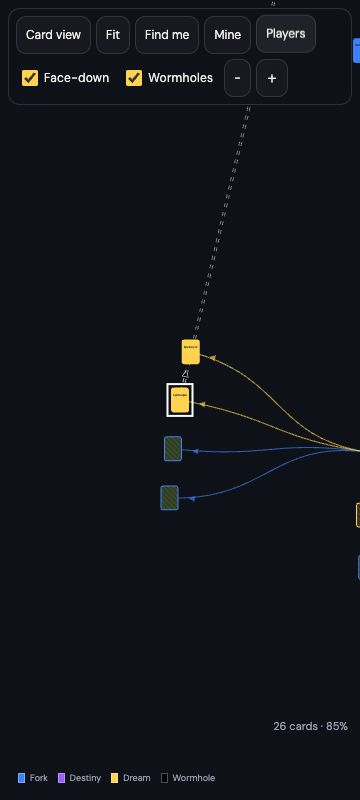

# Jootsy v3 engineering report

Status: **v3 deployed and verified** at code `cd96e44dc3beb619aaf3d061356d62dacf846151`, PR #2. Exactly two v3 production deploys, within the maximum three. The second fixes only the selected player filter’s accessible state; it changes no game rule or migration. Next: Architect reviews §15.9 in the sandbox.

Spec: `architect` at `d94e022`, docs/JOOTSY_TUESDAY_SPEC.md §15. Class URL: https://jootsy.netlify.app/mdst1050 ; QA only: https://jootsy.netlify.app/sandbox . Same managed Netlify Postgres and Netlify Blobs image storage. No retention click required. Instructor passcode unchanged and delivered privately, never in this public repo.

## Review 1

- F1 yes: independent random 32-byte signing secret configured, Functions scope. Code now refuses a missing/short signing key; no passcode fallback.
- F7: 15 v2 production attempts, 14 completed / 1 failed installation. Branch builds were off; previews have now been disabled. All transport and report-only commits use `[skip netlify]`; expanded source is tested with disposable PostgreSQL before its bot commit. Runtime-only ignore rule is a second guard. Two v3 production deploys published, including the final accessibility correction. Total: two of the maximum three. No branch or preview deploy was created.
- F3: hashes prepared before the join world lock; verification remains inside to avoid a reset/login race.
- F5: duplicate-name error now tells newcomers to choose another name.
- F6: main ARCHITECT-NOTES.md is a pointer only; Architect's branch is authoritative. ENGINEER-HANDOFF.md holds engineering updates.

## Migration and rollback

Native v2 database backup is visible at Netlify → jootsy → Data & storage → Database → Backups, production deploy `6af2a665f14267fb389fe8e3`, Nov 10 00:07 ET. The known-good code deploy is `6af2a56caed93547f338e85e` / code commit `2c16471`; published report-only `8d7aea2` has the same runtime code.

Before changing any row, migration `20261110060000_cuts_v3.sql` takes an exclusive lock and copies worlds, players, cards, paths, events and capture time into private `jootsy_v2_snapshot`. No API exposes this schema. It retains the exact immediately-pre-conversion data, including passcode hashes, inside the database only.

If v3 cannot pass by 09:00 ET, restore the native v2 backup via the Restore button on its row, then Netlify → Deploys → known-good deploy `6af2a56caed93547f338e85e` → Publish deploy. A database restore is destructive and needs Neven's confirmation at action time; do not perform it casually or after student writing begins. Prefer preserving the exact migration snapshot if anything changed since 00:07. Until verified, do not claim a rollback has been performed.

## Decisions

- Blank cards are unnamed until written. Their incoming path stores the card's name.
- Existing written v2 slots transfer to the written card's author during migration; unwritten slots retain their original dealer. Thus delete/replay keeps ownership coherent.
- Deletion also checks the blank-card cap because it reopens one blank card. Discard a blank first if already at eight.
- Legacy stress content is kept, with all 40 legacy doors converted to wormhole paths. Layout excludes wormhole paths from its tree.
- No image-description option yet; §15.7 is optional and follows all required acceptance checks.
- Real physical phone performance/pinch remains a manual check; emulated 360px is not represented as physical hardware evidence.

## Verification

| Acceptance | Result and evidence |
|---|---|
| §15.9 1: phone loop | PASS at 360px: fresh join → scenario → Fork → write → play → Fork again, 43.044s. Engineer-run, not a novice usability study or physical-phone timing. |
| 2: another player cuts / news | PASS: Bob dreamed from the new player's written card; one Bob-owned blank appeared, and author news linked back to that card. |
| 3: blank ownership | PASS: live API rejects foreign write/rename/discard with 403. Other blanks are dimmed, disabled and have no discard control. |
| 4: updates | PASS in Chrome + in-app browser: blank 2.588s; new written card 2.09s. Neither receiver reloaded. |
| 5: ten simultaneous forks | PASS in disposable Postgres and live sandbox: twenty distinct blank cards, no errors. |
| 6: eight-blank cap | PASS: ninth refused with exact C6 message, discard frees capacity. |
| 7: Wormhole | PASS UI and API: only own source, own other targets, no self target; black door walked to target. |
| 8: Dead End | PASS: outgoing paths prevent it; new cuts refused on a dead end; Undo and Back to the last fork walked correctly in browser. |
| 9: delete / reopen | PASS: a leaf deletes and becomes its dealer's blank again; any outgoing tree path prevents delete; own wormholes are cleaned up. Browser author rename/delete also checked. |
| 10: author permissions | PASS live API 403 and absent foreign edit/delete controls. |
| 11: incoming colours / arrows | PASS: Dream card frame `--suit:var(--dream)`, yellow Map card, outward coloured arrows. No permanent connection words; tapping a connection revealed Fork. |
| 12: no rings / depth / overlap | PASS: Map has no ring drawing/labels. Disposable stress check confirms radius from depth, deterministic geometry and no node overlap. Fit works at desktop and 360px. |
| 13: Players | PASS: names sorted by played count, Bob at 5; author tap selects his timeline; second tap clears. Final deployed correction verified false → true → false for the player button’s ARIA state. |
| 14: migration | PASS: all 300 legacy stress cards and 40 doors converted and remain walkable; old sandbox card “Touch the silver” retained native video, readyState 4, 960×540, 5.055s. |
| Retained §12 12: scenario admin | PASS: scenario created without starting paths appears to student in 2.83s. |
| Retained §12 14–16 | PASS: Map → Card → Map centres same card; returning identity and wrong passcode checked; literal script text renders as text. |
| Retained §12 17 | PARTIAL: warm stress reload + Map draw 0.812s on this computer; desktop pan/zoom and 360px Fit pass. Real mid-range-phone speed and hardware pinch remain untested. |

Source-expansion runs 11, 12 and 13 passed off main before PR #1 merged: syntax, supported media and identity backs, disposable PostgreSQL model/concurrency/migration/geometry and build. The live sandbox API harness also passed every v3 check after deployment. The in-app browser console had no errors; Chrome reported extension message-channel errors during the walkthrough, with no app failure observed.

No QA writing was put in mdst1050. QA scenario and writing remain in sandbox. All test identities are synthetic. A physical-phone check is the only remaining hardware evidence; “Describe an image” remains intentionally omitted under §15.7.

Final release smoke check: selected player state false → true → false; card view, Map and player counts render correctly; in-app browser error log empty. Source-expansion run 15 passed before the final correction merged. Retained §12 item 17 remains partial; no other acceptance failure found.

